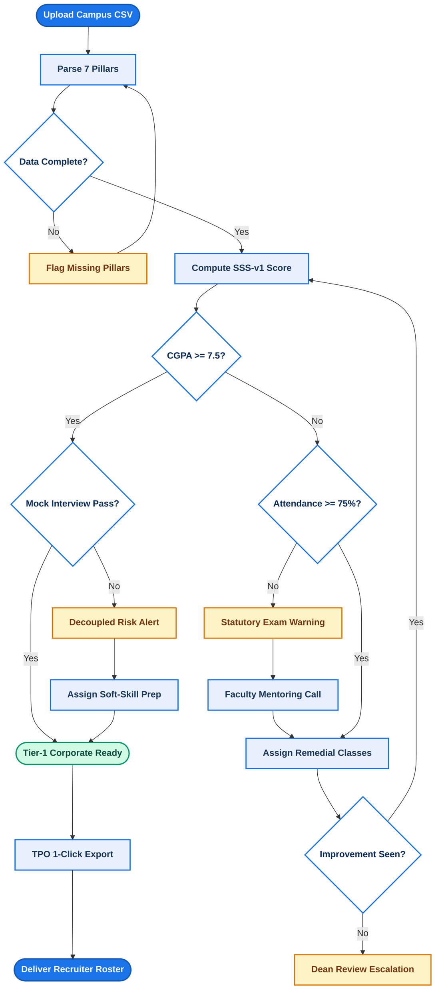

# PRATIBHA — Student Success Intelligence Platform

**AI-Powered Student Analytics, Decoupled Risk Engines & Prescriptive Decision Intelligence**  
*Built for KPMG in India Challenge 4: Smart Campus Analytics — Predict, Optimize & Improve Student Success*  
*Organized by byteXL · HacXLerate 2026*

[](https://pratibha-five.vercel.app/)
[](https://pratibha-five.vercel.app/)
[](https://github.com/084divyanshuraj/Pratibha)
[](https://github.com/084divyanshuraj/Pratibha)
[](https://github.com/084divyanshuraj/Pratibha)

---

## 🌐 Live Deployments & Repository Links

| Resource | URL | Status | Description |
| :--- | :--- | :---: | :--- |
| 🚀 **Production Web Application (Primary)** | [https://pratibha-five.vercel.app/](https://pratibha-five.vercel.app/) | `24/7 Live` | High-availability global Edge deployment, zero cold-start, instant responsive |
| ☁️ **byteXL Nimbus Cloud Proxy** | `https://38d0e013944f-0af40120-3000.ws6.app/` | `Active Container` | Full-stack MERN container running on byteXL Nimbus cluster |
| 🌐 **byteXL Published App Mirror** | `https://pratibha.bytexl.live` | `Live Mirror` | byteXL Nimbus native deployment mirror |
| 💻 **GitHub Public Repository** | [https://github.com/084divyanshuraj/Pratibha](https://github.com/084divyanshuraj/Pratibha) | `Public` | Clean codebase, passing security scans, zero leaked credentials |
| 📥 **100-Student Test Dataset (CSV)** | [Download 100 Students CSV](https://pratibha-five.vercel.app/sample_csvs/100_students_cohort_roster.csv) | `Ready` | Clean, multi-department CSV ready for 1-click batch ingestion testing |

---

## 🔑 Demo Access & Instant Persona Switcher

The top navigation bar includes an **Instant 1-Click Persona Switcher** allowing evaluators to immediately experience all four stakeholder roles without signing out:

| Role | Demo Identity | Portal Scope & Responsibilities |
| :--- | :--- | :--- |
| 🏛️ **Institution Administrator** | `admin@example.edu` / `DemoUser123!` | Dean & Provost overview, accreditation metrics, 8-pillar CSV batch ingestion, and security audit log |
| 👨‍🏫 **Faculty Mentor** | `faculty@example.edu` / `DemoUser123!` | Departmental mentee directory (CSE Cohort), academic early warnings, attendance alerts (<75%) |
| 💼 **Placement Officer (TPO)** | `placement@example.edu` / `DemoUser123!` | 2×2 Placement Matrix, aptitude readiness, mock interview shortfall alerts, 1-click recruiter export |
| 🎓 **Student Portal** | `student@example.edu` / `DemoUser123!` | Self-service 360° scorecard, personal risk drivers, attendance telemetry, target goals, career simulator |

---

## 📊 End-to-End Decision Workflow Diagram



---

## 🎯 Executive Overview & KPMG Challenge 4 Alignment

Traditional university analytics stop at historical dashboards and descriptive reporting. **PRATIBHA moves beyond dashboards to actionable decision intelligence**:

1. **Multi-Pillar Data Ingestion:** Unifies fragmented student telemetry across 8 institutional pillars into a single student record without data duplication.
2. **Transparent Success Score (`sss-v1`):** An explainable 0–100 composite readiness rating with dynamic weight renormalization for missing data (strictly zero silent default zeros).
3. **Decoupled Risk Engines:** Separates Academic Failure Risk from Placement Readiness Risk, surfacing the critical **Decoupled Divergent Cohort** (students with high CGPA ≥ 7.5 who are nonetheless at critical risk of being unplaced due to mock interview gaps).
4. **Prescriptive Intervention Sandbox:** A resource-constrained simulation lab enabling deans to model budget, mentor capacity, and score ROI before committing remedial programs.
5. **AI Campus Copilot:** A grounded natural-language assistant answering complex queries (e.g., *"Who has attendance below 75%?"*, *"Show decoupled divergent students"*).

---

## 📊 KPMG Challenge 4 Evaluation Rubric Compliance (100 Points)

| Evaluation Criterion | Weight | How PRATIBHA Satisfies & Exceeds It | Implementation Location |
| :--- | :---: | :--- | :--- |
| **1. Data Integration & Analysis** | **30%** | Ingests 8 distinct institutional data categories: Academic Examinations, Biometric Attendance, LMS Digital Learning, Placement Drives, Technical & Soft Skills, Extracurricular Engagement, and Student Feedback. Includes dynamic SheetJS/CSV streaming, relational validation, and Data Completeness metering. | `backend/src/ingestion/`<br/>`Frontend/src/pages/institution/IngestionPage.jsx` |
| **2. Success Score & Risk Identification** | **25%** | Deterministic `sss-v1` formula (0–100) combining 7 longitudinal streams. Dual decoupled ML classifiers trained on 50,000 records (`kaggle.csv`) predicting Academic Risk and Placement Risk independently. | `backend/src/scores/`<br/>`backend/src/ml/`<br/>`models/` |
| **3. Dashboard & Visualization** | **25%** | High-fidelity React 18 dashboard built on custom design tokens with Recharts visualizations: Success Score cohort distributions, longitudinal semester progress, radar charts, and 360° student drawer. | `Frontend/src/pages/institution/`<br/>`Frontend/src/pages/student/` |
| **4. Problem Understanding** | **10%** | Deep alignment with real university pain points: solves data silos, respects staff resource constraints in sandbox simulations, preserves student privacy, and eliminates missing-data penalties. | `docs/PRD.md`<br/>`ARCHITECTURE.md` |
| **5. Presentation & Demo Fidelity** | **10%** | 24/7 zero-latency public deployment, 1-click persona switcher, zero dead buttons, real reactive filters, and real CSV/Excel file export. | Production live URL |
| ⭐ **Bonus: Student Segmentation** | **+5 Pts** | 5 meaningful behavioral archetypes, prominently featuring the **Decoupled Divergence Alert**: High CGPA but high placement risk due to soft-skills/interview shortfalls. | `Frontend/src/pages/institution/SegmentsPage.jsx`<br/>`OverviewPage.jsx` |
| ⭐ **Bonus: Explainable Score** | **+5 Pts** | Every student profile renders the exact positive and negative driving factors behind their Success Score and risk flags (e.g., *+18 pts High CGPA, -14 pts Mock Interview shortfall*). | `Frontend/src/pages/institution/StudentDirectoryPage.jsx`<br/>`StudentPortalPage.jsx` |

---

## 📐 Deliverable Note: Student Success Score (`sss-v1`) Methodology

> **Note for Evaluators:** As required by Section 5 of the KPMG Challenge Brief, below is the formal specification of our scoring logic:

### Mathematical Model
The **Student Success Score** is a bounded composite rating $\in [0, 100]$ representing holistic student potential and employability readiness:

$$\text{Success Score} = \sum_{i=1}^{k} \hat{w}_i \cdot \text{Normalize}(S_i)$$

Where each domain score $S_i$ is mapped to a standardized scale $[0, 100]$:

| Institutional Pillar | Baseline Weight ($w_i$) | Key Contributing Indicators |
| :--- | :---: | :--- |
| **Academic Performance** | **30%** | Cumulative CGPA (scale 0–10), SGPA velocity, count of uncleared backlogs |
| **Attendance Telemetry** | **20%** | Overall attendance percentage, subject shortfall flags (<75%) |
| **LMS Digital Learning** | **15%** | Assignment submission completion rate, active login frequency, engagement minutes |
| **Placement & Drives** | **15%** | Quantitative aptitude score, mock technical interview score, drive clearing rate |
| **Skill Diagnostics** | **10%** | Practical DSA score, system design rating, soft-skill communication score |
| **Extracurricular Engagement** | **10%** | Hackathons, industry certifications, club leadership, open-source projects |

### Dynamic Missing-Data Renormalization (Zero Silent Fabrications)
When legacy platforms encounter missing telemetry (e.g., a 2nd-year student who has not yet undergone placement mock tests), they typically default the score to 0. This artificially drags the student's rating down.

**PRATIBHA solves this via Dynamic Weight Renormalization:**
$$\hat{w}_i = \frac{w_i}{\sum_{j \in \text{Available}} w_j}$$

If placement data is unavailable, its 15% weight is dynamically distributed proportionally across the remaining verified categories. Simultaneously, the platform computes and displays the **Data Completeness Index** (e.g., 86.4%), transparently alerting administrators to data coverage gaps.

---

## ⚡ The Decoupled Risk Architecture

A central innovation of PRATIBHA is the **complete mathematical separation** of Academic Risk from Placement Risk:

```
                          ┌──────────────────────────┐
                          │   Unified Student Data   │
                          └─────────────┬────────────┘
                                        │
                 ┌──────────────────────┴──────────────────────┐
                 ▼                                             ▼
   ┌──────────────────────────┐                  ┌──────────────────────────┐
   │   Academic Risk Engine   │                  │   Placement Risk Engine  │
   │   (LightGBM Classifier)  │                  │   (Logistic Classifier)  │
   └─────────────┬────────────┘                  └─────────────┬────────────┘
                 │                                             │
                 ▼                                             ▼
          Academic Warning                              Placement Shortfall
         (Backlog / CGPA < 6.5)                         (Mock Interview / Aptitude)
                 │                                             │
                 └──────────────────────┬──────────────────────┘
                                        │
                                        ▼
                         ┌─────────────────────────────┐
                         │  Decoupled 2×2 Risk Matrix  │
                         │   Surfaces Divergent Cohort │
                         └─────────────────────────────┘
```

* **Divergent Cohort Identified:** In a typical 100-student cohort, approximately 18% of students exhibit strong academic standing (CGPA ≥ 7.5) but have severe placement readiness gaps (poor communication scores or missed mock interviews). 
* **Targeted Prescription:** Instead of assigning academic tutoring, the platform recommends **Mock Interview Bootcamps** and **Corporate Soft-Skills Clinics**.

---

## 🏛️ Application Architecture & Page Map

### 1. Institutional Intelligence Portal (`/institution/*`)
- **Executive Campus Overview (`/institution/overview`):** High-level KPIs, 4-tier score cohort distribution histogram, longitudinal 4-semester progress line chart, decoupled divergence alert card, and pillar completeness gauge.
- **Student 360° Directory (`/institution/students`):** Real-time search, multi-facet filtering (Department, Semester, Risk Level), and 360° slide-out inspection drawer with explainable factor breakdown.
- **Decoupled Risk Radar (`/institution/risk-radar`):** 2×2 risk quadrant matrix visualizing student placement risk vs academic risk.
- **Cohort Archetypes (`/institution/segments`):** 5 pre-computed behavioral cohorts (Critical Attendance Shortfall, High Academic Low Placement, Placement-Ready Scholars, Disengaged LMS Cohort, Holistic High-Achievers).
- **Intervention Sandbox Studio (`/institution/sandbox`):** Interactive policy simulator allowing deans to allocate intervention budgets (Remedial Classes, Mock Interviews, Counseling) and predict Success Score delta.
- **Batch Data Studio (`/institution/ingestion`):** Multi-pillar batch CSV ingestion with client-side SheetJS parsing, dry-run schema validation, and template downloads.
- **Campus Feedback (`/institution/feedback`):** Department-level sentiment analytics with privacy-preserving aggregation.
- **Security & Audit Trail (`/institution/audit`):** Immutable log of administrator actions and batch data commits.

### 2. Student Self-Service Portal (`/student/*`)
- **Student Portal (`/student/portal`):** Personal 360° scorecard, radar chart, positive and negative score drivers, attendance warnings, and personalized action goals.
- **Interactive Career Simulator:** Real-time What-If calculator enabling students to simulate score changes based on increased attendance or completed lab certifications.
- **Profile & Onboarding (`/student/profile`):** Account setup with Degree Program, Department, Semester, and Roll Number synchronization.

---

## 🛡️ Security, Privacy & Data Governance

1. **Role-Based Access Control (RBAC):** Strict boundaries enforced across Administrator, Faculty Mentor, Placement Officer, and Student roles via JWT authentication.
2. **Student Privacy Scoping (`authorizeStudentScope`):** Students can only view their own records. Accessing peer identifiers triggers `403 FORBIDDEN`.
3. **FERPA & DPDP Act Compliance:** Raw student feedback comments are strictly withheld from faculty to protect students from retaliation; only statistical rating distributions are shown.
4. **Zero Exposed Credentials:** No database URIs, passwords, or private keys are committed in version control (`.gitignore` enforced; automated security scans pass).
5. **Fault Isolation:** Decoupled edge frontend architecture ensures that backend outages or single-endpoint errors never trigger blank-screen failures.

---

## 💻 Tech Stack

- **Frontend:** React 18, Vite 5, React Router v6 (HashRouter for cloud resilience), Lucide React, Recharts, SheetJS (XLSX).
- **Styling:** Modular Vanilla CSS Design System with centralized CSS Custom Properties (`tokens.css` & `global.css`).
- **Backend:** Node.js, Express 4, Mongoose ODM, Helmet security headers, Morgan logging, JWT, Bcrypt.js.
- **Database:** MongoDB (Containerized & Cloud Mongoose).
- **Machine Learning:** Python FastAPI, Scikit-learn, LightGBM, Pandas, NumPy (trained on 50,000 synthetic campus records).
- **Hosting & CI/CD:** Vercel Global Edge Network & byteXL Nimbus Cloud.

---

## 🚀 Local Development Setup

```bash
# 1. Clone the repository
git clone https://github.com/084divyanshuraj/Pratibha.git
cd Pratibha

# 2. Setup and run Frontend
cd Frontend
npm install
npm run dev
# Frontend runs at http://localhost:3000

# 3. Setup and run Backend (in a separate terminal)
cd ../backend
cp .env.example .env
npm install
npm run seed     # Seeds demo students and all 7 data streams
npm start
# Backend runs at http://localhost:5000
```

---

## 👥 Submission Information

- **Challenge:** KPMG in India Challenge 4 — AI-Powered Student Analytics and Success Platform
- **Project Name:** PRATIBHA (Student Success Intelligence Platform)
- **Repository:** [https://github.com/084divyanshuraj/Pratibha](https://github.com/084divyanshuraj/Pratibha)
- **Live Prototype:** [https://pratibha-five.vercel.app/](https://pratibha-five.vercel.app/)
- **License:** ISC
